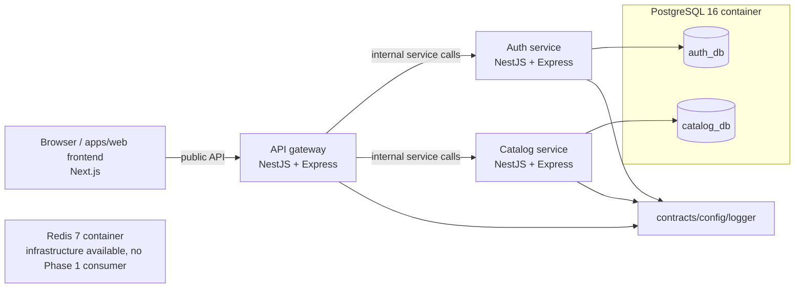

# Phase 1 architecture

## Purpose

Phase 1 provides the smallest independently runnable Nexo Commerce platform foundation. It establishes a strict TypeScript workspace, local infrastructure, explicit service ownership, safe HTTP conventions, and a storefront shell. Its public topology places the API Gateway between the browser-facing frontend and the domain services, with active HTTP/REST forwarding for Auth and Catalog.

## Components

Browser-facing application traffic reaches Auth and Catalog only through the API Gateway; neither microservice is a browser-facing API. The Gateway's public routes are `/api/auth/*`, `/api/products/*`, and `/api/categories`.

`apps/web` is a Next.js App Router storefront. Its product client calls `${NEXT_PUBLIC_API_GATEWAY_URL}/products`, maps the Catalog public response into the product cards, and renders loading, empty, error, and ready states. The only browser API URL it receives is the Gateway URL; it has no Catalog Service configuration.

`apps/api-gateway` uses the `/api` prefix and provides `GET /api/health` plus Swagger at `/api/docs`. `AUTH_SERVICE_URL` and `CATALOG_SERVICE_URL` are required internal REST origins. The Gateway forwards the known Auth, Product, and Category routes with their method, query string, JSON body, `Authorization`, `Accept`, `Content-Type`, and Gateway request ID. Upstream HTTP responses retain their status and body; a connection failure or timeout becomes the public `503 SERVICE_UNAVAILABLE` envelope without disclosing service details.

`apps/auth-service` owns registrations, logins, refresh-token rotation, and authenticated identity lookup. `apps/catalog-service` owns category/product/variant reads and writes. These applications are independently startable NestJS applications using the Express platform adapter.

## Data ownership

The local Docker Compose PostgreSQL server initializes two databases: `auth_db` and `catalog_db`. This is logical database-per-service isolation for local development, not two separate PostgreSQL servers. Auth alone owns its Prisma schema, migration history, generated client, and `User`/`RefreshToken` tables. Catalog alone owns the equivalent artifacts for `Category`, `Product`, and `ProductVariant`. No persistence package is shared, and one service does not import another service's entities or tables.

Redis has a persistent Compose volume and health check but no Phase 1 code consumes it.

## HTTP and configuration safeguards

The backend services run on NestJS with Express, and each configures:

- Helmet. The Gateway alone enables browser CORS; Auth and Catalog are internal HTTP targets.
- DTO validation with transformation, whitelisting, and rejection of unknown fields.
- An `x-request-id`: a valid inbound UUID is propagated; otherwise a UUID is generated. It is included in every response and public error envelope.
- Structured request-completion logs that contain method, path, status, duration, service, and request ID; request bodies, query strings, and headers are not logged by this middleware.
- A global exception boundary with public `{ statusCode, code, message, requestId }` errors and no persistence internals/stack traces.

The configuration package validates `NODE_ENV`, ports, and service-specific required values at runtime. Auth requires a PostgreSQL `DATABASE_URL`, two distinct secrets of at least 32 characters, and bounded positive JWT TTL values. Catalog requires a PostgreSQL `DATABASE_URL`. The `.env.example` files contain the local values and ports; see the root README for the required setup and the difference between service startup and direct root-level Prisma validation.

Auth hashes passwords and refresh tokens with Argon2. Its access and refresh tokens use independent secrets; refresh rotation revokes the source token before issuing the replacement. `GET /auth/me` is JWT-protected.

## Catalog boundary

Public Catalog reads are `GET /products`, `GET /products/:slug`, and `GET /categories`. The write routes (`POST /categories`, `POST /products`, and `PATCH /products/:id`) are **temporary unauthenticated administration endpoints**. Their lack of authorization is deliberately explicit and is not suitable for public production administration. Authorization is deferred until a cross-service boundary is selected.

Catalog validates and maps persistence objects to deliberate public response shapes. Product creation is atomic with its variants. Product pricing accepts decimal strings rather than JavaScript numbers to avoid float corruption, and stores `DECIMAL(18,2)` values. Details of the current HTTP contract are in [the Catalog service README](../../apps/catalog-service/README.md).

## Operational sequence

For a clean local Docker environment, first copy root and app `.env.example` files, run `pnpm db:up`, generate both Prisma clients, and deploy both service migrations before starting database-backed services. Gateway loads its app-local `.env` through `dotenv` and requires internal `AUTH_SERVICE_URL`/`CATALOG_SERVICE_URL`; Auth and Catalog use `dotenv/config`. Their default ports are 3003, 3001, and 3002 respectively, while the Next.js storefront uses 3000 and requires `NEXT_PUBLIC_API_GATEWAY_URL=http://localhost:3003/api`; `pnpm dev` can therefore start all four applications without a listener collision. Compose health endpoints and application `/health` routes are liveness indicators. In particular, `/health` does not prove that a database connection or migration is live.

## Deliberately deferred

This phase does not implement a cart, orders, checkout/payments, notifications, message brokers, distributed authorization, Redis integration, Kubernetes, Terraform, or production deployment. Those omissions keep the first phase focused on stable ownership boundaries and a narrow HTTP integration protocol.
