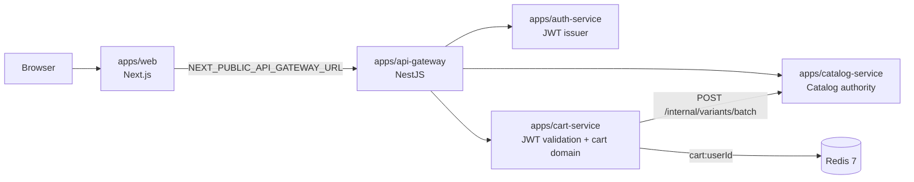

# Phase 2 architecture

## Purpose

Phase 2 adds an authenticated, temporary shopping Cart without changing service ownership. The API Gateway remains the only browser API. Cart owns user-selected variant IDs and quantities in Redis; Catalog remains the authority for product activity, variant activity, price, currency, and stock.

## Components and trust boundaries



The browser never receives `CART_SERVICE_URL` or `CATALOG_SERVICE_URL`. Cart has no CORS configuration and is reachable from the browser only through the five explicit Gateway routes. Catalog's `/internal/*` namespace is not proxied by the Gateway.

## Public API

The Gateway exposes these authenticated Cart routes:

| Gateway route | Cart operation |
| --- | --- |
| `GET /api/cart` | Read and enrich the current cart |
| `POST /api/cart/items` | Add `{ variantId, quantity }` |
| `PATCH /api/cart/items/:variantId` | Replace `{ quantity }` |
| `DELETE /api/cart/items/:variantId` | Remove one line, idempotently |
| `DELETE /api/cart` | Clear the cart, idempotently |

Cart validates the Auth-issued HS256 access JWT locally using the shared access secret. It accepts only an unexpired token with a UUID `sub` and `type: "access"`. Catalog validates the same signed claims and additionally requires an Auth-issued ADMIN proof derived from the separate `CATALOG_ADMIN_SECRET`; Cart does not receive that secret and cannot forge Catalog administrator claims. Valid `x-request-id` values are preserved across Gateway, Cart, and Cart's Catalog lookup.

## Catalog integration

Cart calls Catalog's private `POST /internal/variants/batch` endpoint with up to 100 UUIDs and the configured `CATALOG_INTERNAL_TOKEN` in `x-internal-service-token`. Catalog rejects missing or incorrect service credentials with 401. This explicit shared-secret strategy is the current Phase 2 service-to-service authentication mechanism and can be replaced by infrastructure-level identity, mTLS, or a dedicated authorization system later. The route is not exposed by the public Gateway.

Catalog returns a narrow projection containing variant/product IDs, names, decimal-string price, currency, stock, and both active flags. Missing variants are absent from the result and are returned by Cart as `available: false` lines with zero subtotal so users can remove them. Transport failures, timeouts, non-success responses, malformed JSON, and interrupted bodies become `503 CATALOG_UNAVAILABLE`.

Cart validates adds and quantity updates against one current Catalog batch before writing. Their responses enrich the exact state returned by the atomic Redis mutation with that same batch, so a later Catalog outage cannot turn a committed write into a failed response. Removes and clears do not require Catalog. Cart does not import Catalog Prisma code, access `catalog_db`, reserve inventory, or decrement stock.

## Redis lifecycle

The only Cart persistence key is `cart:{userId}`. Its JSON value is:

```json
{
  "currency": "USD",
  "items": [{ "variantId": "uuid", "quantity": 2 }],
  "updatedAt": "2026-09-13T00:00:00.000Z"
}
```

Each save uses `EX 2592000` (30 days). Adds, quantity replacements, and item removals that leave lines renew the TTL. Reads do not renew it. Removing the final line deletes the key, so an empty cart has no currency. Malformed persisted state fails closed at the repository boundary rather than reaching Cart domain logic.

Cart add, update, remove, and clear mutations use one Redis Lua script per operation, making each state transition atomic for a user key while preserving the TTL rule. Redis operational failures return `503 CART_STORAGE_UNAVAILABLE` and are logged with the request ID without Redis connection details.

If another writer introduces a variant outside the validated batch before an add or update commits, the script rejects it without writing with `409 CART_CONCURRENT_MODIFICATION`; the caller can retry. Concurrent quantity changes and removals of other lines are reflected in the committed response. Disconnected Redis commands fail without offline queueing, so reconnecting does not replay deferred cart mutations.

The first current Catalog variant establishes the Cart currency. A later incompatible currency returns `409 CART_CURRENCY_MISMATCH` and leaves Redis unchanged. A currency change in Catalog for an existing line also fails closed until that line is removed.

## Frontend boundary

The storefront uses only `NEXT_PUBLIC_API_GATEWAY_URL` and the existing `localStorage` key `nexo.access-token`. The home page selects the first active product variant for Add to Cart. `/cart` renders loading, empty, error, update, remove, and clear states. An initial `CART_CURRENCY_MISMATCH` exposes Clear cart even without a loaded cart; it deletes through the Gateway and refreshes the empty cart. Missing or expired tokens render an actionable sign-in error; Phase 2 does not add a sign-in UI.

Cart responses use current Catalog prices and decimal-string subtotal/total calculations. Cart prices are not commitments; a future Order flow must snapshot its own prices.

## Operational limitations

- Stock validation is advisory until checkout; no reservation or atomic stock claim exists.
- Inactive or unavailable lines remain removable so users can recover a cart after Catalog changes.
- Phase 2 does not implement Orders, checkout, payments, notifications, brokers, or Cart PostgreSQL persistence.
- Redis is required for Cart startup and is provisioned by the local Compose stack.
