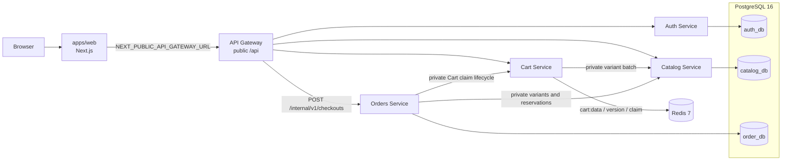

# Phase 3 architecture: checkout and inventory reservations

## Purpose and boundary

Phase 3 turns a principal-scoped Cart into a durable checkout attempt. It adds an Orders service and Catalog-owned reservations without adding payments, confirmation, messaging, or a public Orders API. The API Gateway remains the only browser API.



Only `Web → Gateway` is browser traffic. `AUTH_SERVICE_URL`, `CATALOG_SERVICE_URL`, `CART_SERVICE_URL`, and `ORDERS_SERVICE_URL` are private server configuration. The browser knows only `NEXT_PUBLIC_API_GATEWAY_URL`; it does not know Catalog, Cart, or Orders origins.

## Ownership and checkout lifecycle

| Owner | Responsibility |
| --- | --- |
| Cart | Redis Cart lines, a monotonic principal-scoped version, and an active checkout claim. A claim blocks Cart edits. |
| Catalog | Product sellability, exact decimal prices, `onHand`, `reserved`, and atomic reservation/publication/release/expiry. `available = onHand - reserved`. |
| Orders | Idempotency attempts, immutable order/line snapshots, current order state, leases, and recovery progress. It never changes Catalog stock directly. |
| Gateway | Public boundary, request-ID propagation, forwarded JWT/idempotency key, and the `CHECKOUT_ENABLED` rollout gate. |

`POST /api/checkout` needs `Authorization: Bearer <access JWT>`, `Idempotency-Key`, and an `expectedPrices` item for every current Cart variant. Gateway forwards it only to Orders at `POST /internal/v1/checkouts`; Orders verifies the existing HS256 access JWT locally and derives the principal from `sub`.

Orders claims the current Cart version, compares browser prices with Catalog's exact decimal strings, then asks Catalog to reserve every line atomically. Catalog computes `reservedAt` and `expiresAt` from its own UTC clock; a reservation is exactly 15 minutes and never has its deadline extended. It publishes `ACTIVE → PUBLISHED` only before expiry. The publish transition is the linearization point for a visible `PENDING` order.

The first accepted checkout returns `201` with `PENDING`. A same-key/same-body replay reconciles current Catalog state and returns `200` with the same order snapshot as `PENDING` or `EXPIRED`; it never creates another reservation. A different body for the same key returns `409 IDEMPOTENCY_KEY_REUSED`. An uncertain attempt returns `202 CHECKOUT_PROCESSING` without exposing an incomplete order. `CHECKOUT_PRICE_CHANGED` returns canonical `details.currentPrices`; the Web client refreshes the Cart and requires explicit reconfirmation using a new key.

Valid `x-request-id` values are generated or preserved at Gateway and propagated to Orders, Cart, and Catalog. They correlate logs only; they are neither identity nor idempotency credentials. Private Cart and Catalog calls require their configured internal service tokens; user JWTs are not forwarded from Orders to Cart.

## Persistence, migration, and rollout

Local PostgreSQL 16 has three logical databases: `auth_db`, `catalog_db`, and `order_db`. Apply migrations with their owner only:

```powershell
pnpm db:up
pnpm auth:prisma:generate; pnpm auth:prisma:migrate
pnpm catalog:prisma:generate; pnpm catalog:prisma:migrate
pnpm orders:prisma:generate; pnpm orders:prisma:migrate
```

Catalog migrations must be present before checkout is enabled because Catalog owns the reservation state and expiry worker. Orders migrations create durable attempts, orders, lines, and recovery records.

For an existing Phase 2 Redis dataset, stop Cart writes first, run the one-time key migration, and investigate any nonzero exit rather than deleting data:

```powershell
pnpm --filter @nexo/cart-service migrate:keys
```

It moves a valid legacy `cart:{principalId}` to `cart:data:{principalId}`, preserves its remaining payload TTL, and creates a non-expiring `cart:version:{principalId}`. `cart:claim:{principalId}` contains the active claim/terminal recovery metadata. Do not delete version or claimed keys as routine cleanup: a missing counter beside data/claim fails closed. Unclaimed payloads retain the 30-day TTL; a claim removes the payload TTL until Orders completes or releases it.

The Gateway kill switch defaults to closed when `CHECKOUT_ENABLED` is omitted. Set `CHECKOUT_ENABLED=true` only after the migration and health checks pass. Set it to `false` to stop **new** public checkout requests with a safe 503; leave Orders, Catalog, Cart, their recovery/expiry workers, and existing data running so active claims/reservations can reach a terminal state. Rollback therefore means: close the gate first, retain migrations and durable state, reconcile attempts/reservations, then investigate. It is not safe to delete Orders/Catalog rows or Redis claim/version keys as a rollback shortcut.

## Local ports and startup

| Component | Port | Public use |
| --- | ---: | --- |
| Web | 3000 | Browser storefront |
| API Gateway | 3003 | Only browser/API entry point, including Swagger at `/api/docs` |
| Auth | 3001 | Local health/diagnostic target |
| Catalog | 3002 | Local health/diagnostic target |
| Cart | 3004 | Local health/diagnostic target |
| Orders | 3005 | Local health/diagnostic target |
| PostgreSQL | 5432 | Local infrastructure |
| Redis | 6379 | Local infrastructure |

Copy `.env.example` plus every service `.env.example` as described in the root README, ensure `apps/api-gateway/.env` includes `CHECKOUT_ENABLED=true` for local checkout, then run `pnpm dev`. Direct service ports are not frontend endpoints.

## Docker-backed checkout checklist

This is an executable, disposable local validation for PowerShell 7. It seeds Catalog through the Gateway, creates a customer Cart through the Gateway, and submits checkout through the Gateway. The two direct PostgreSQL/Catalog stock mutations are local test setup only; browser traffic never uses them.

1. Start Compose, generate/apply migrations, and start all services as shown above. Confirm `GET http://localhost:3003/api/health` and `GET http://localhost:3005/health` return 200.
2. In a new PowerShell window, create a disposable administrator, promote it in the local Auth database, then log in again for a token bearing the ADMIN proof:

```powershell
$api = 'http://localhost:3003/api'
$password = 'correct-horse-battery-staple'
$suffix = [guid]::NewGuid().ToString('N')
$adminEmail = "phase3-admin-$suffix@example.test"
$adminRegistration = @{ email = $adminEmail; password = $password; firstName = 'Phase'; lastName = 'Admin' }
Invoke-RestMethod -Method Post -Uri "$api/auth/register" -ContentType 'application/json' -Body ($adminRegistration | ConvertTo-Json) | Out-Null
docker compose exec -T postgres psql -U nexo -d auth_db -v ON_ERROR_STOP=1 -c "UPDATE ""User"" SET role = 'ADMIN' WHERE email = '$adminEmail';"
$admin = Invoke-RestMethod -Method Post -Uri "$api/auth/login" -ContentType 'application/json' -Body (@{ email = $adminEmail; password = $password } | ConvertTo-Json)
$adminHeaders = @{ Authorization = "Bearer $($admin.accessToken)" }
```

3. Seed a category and product through the Gateway. Keep both variant IDs: the first tests price/replay/expiry and the second tests an inventory race.

```powershell
$category = Invoke-RestMethod -Method Post -Uri "$api/categories" -Headers $adminHeaders -ContentType 'application/json' -Body (@{ name = "Phase 3 $suffix"; slug = "phase-3-$suffix" } | ConvertTo-Json)
$productBody = @{
  name = "Phase 3 product $suffix"; slug = "phase-3-product-$suffix"; description = 'Disposable local checkout product'; categoryId = $category.id
  variants = @(
    @{ sku = "P3-$suffix-A"; name = 'Reservation variant'; price = '12.00'; currency = 'USD'; stock = 10 },
    @{ sku = "P3-$suffix-B"; name = 'Stock-race variant'; price = '7.00'; currency = 'USD'; stock = 1 }
  )
}
$product = Invoke-RestMethod -Method Post -Uri "$api/products" -Headers $adminHeaders -ContentType 'application/json' -Body ($productBody | ConvertTo-Json -Depth 5)
$reservationVariantId = $product.variants[0].id
$stockVariantId = $product.variants[1].id
```

4. Register a customer, add the first variant through Gateway, then force a local Catalog price change. The failed checkout proves expected prices are a comparison, not an authority:

```powershell
$customerEmail = "phase3-customer-$suffix@example.test"
$customer = Invoke-RestMethod -Method Post -Uri "$api/auth/register" -ContentType 'application/json' -Body (@{ email = $customerEmail; password = $password; firstName = 'Phase'; lastName = 'Customer' } | ConvertTo-Json)
$customerHeaders = @{ Authorization = "Bearer $($customer.accessToken)" }
$cart = Invoke-RestMethod -Method Post -Uri "$api/cart/items" -Headers $customerHeaders -ContentType 'application/json' -Body (@{ variantId = $reservationVariantId; quantity = 1 } | ConvertTo-Json)
$oldPrice = $cart.items[0].price
docker compose exec -T postgres psql -U nexo -d catalog_db -v ON_ERROR_STOP=1 -c "UPDATE ""ProductVariant"" SET price = 13.00 WHERE id = '$reservationVariantId';"
$traceId = [guid]::NewGuid().ToString()
$priceKey = "price-change-$suffix"
$priceHeaders = @{ Authorization = $customerHeaders.Authorization; 'Idempotency-Key' = $priceKey; 'x-request-id' = $traceId }
$priceFailure = Invoke-WebRequest -SkipHttpErrorCheck -Method Post -Uri "$api/checkout" -Headers $priceHeaders -ContentType 'application/json' -Body (@{ expectedPrices = @(@{ variantId = $reservationVariantId; price_decimal = $oldPrice; currency = 'USD' }) } | ConvertTo-Json -Depth 5)
$priceFailure.StatusCode             # 409
($priceFailure.Content | ConvertFrom-Json).code  # CHECKOUT_PRICE_CHANGED
```

5. Reconfirm the canonical price with a new idempotency key. Replay that key unchanged to prove one stable order and preserve the trace ID:

```powershell
$checkoutKey = "checkout-$suffix"
$checkoutHeaders = @{ Authorization = $customerHeaders.Authorization; 'Idempotency-Key' = $checkoutKey; 'x-request-id' = $traceId }
$checkoutBody = @{ expectedPrices = @(@{ variantId = $reservationVariantId; price_decimal = '13.00'; currency = 'USD' }) } | ConvertTo-Json -Depth 5
$first = Invoke-WebRequest -Method Post -Uri "$api/checkout" -Headers $checkoutHeaders -ContentType 'application/json' -Body $checkoutBody
$first.StatusCode                         # 201
$first.Headers['x-request-id'] -eq $traceId # True
$order = $first.Content | ConvertFrom-Json
$order.state                               # PENDING
$replay = Invoke-WebRequest -Method Post -Uri "$api/checkout" -Headers $checkoutHeaders -ContentType 'application/json' -Body $checkoutBody
$replay.StatusCode                         # 200
(($replay.Content | ConvertFrom-Json).orderId -eq $order.orderId) # True
```

6. Exercise insufficient stock after a Cart read by adding the second variant, reducing its local on-hand value with the authenticated Catalog admin route, and checking the Gateway conflict. This direct Catalog call is a local race setup, not a browser route:

```powershell
Invoke-RestMethod -Method Post -Uri "$api/cart/items" -Headers $customerHeaders -ContentType 'application/json' -Body (@{ variantId = $stockVariantId; quantity = 1 } | ConvertTo-Json) | Out-Null
Invoke-RestMethod -Method Patch -Uri "http://localhost:3002/variants/$stockVariantId/stock" -Headers $adminHeaders -ContentType 'application/json' -Body (@{ onHand = 0 } | ConvertTo-Json) | Out-Null
$stockHeaders = @{ Authorization = $customerHeaders.Authorization; 'Idempotency-Key' = "stock-$suffix" }
$stockFailure = Invoke-WebRequest -SkipHttpErrorCheck -Method Post -Uri "$api/checkout" -Headers $stockHeaders -ContentType 'application/json' -Body (@{ expectedPrices = @(@{ variantId = $stockVariantId; price_decimal = '7.00'; currency = 'USD' }) } | ConvertTo-Json -Depth 5)
($stockFailure.Content | ConvertFrom-Json).code  # INSUFFICIENT_STOCK
```

7. On this disposable dataset, force the accepted reservation deadline into the past and replay the same key. This demonstrates reconciliation from visible `PENDING` to current `EXPIRED` without waiting 15 minutes:

```powershell
$attemptId = docker compose exec -T postgres psql -U nexo -d order_db -t -A -c "SELECT checkout_attempt_id FROM orders WHERE id = '$($order.orderId)';"
# Keep the Catalog invariant exactly intact: expiresAt - reservedAt is 15 minutes.
$expirySql = "WITH t AS (SELECT clock_timestamp() AS now) UPDATE ""StockReservation"" SET ""reservedAt"" = t.now - interval '16 minutes', ""expiresAt"" = t.now - interval '1 minute' FROM t WHERE ""attemptId"" = '$attemptId';"
docker compose exec -T postgres psql -U nexo -d catalog_db -v ON_ERROR_STOP=1 -c $expirySql
$expired = Invoke-WebRequest -Method Post -Uri "$api/checkout" -Headers $checkoutHeaders -ContentType 'application/json' -Body $checkoutBody
$expired.StatusCode                            # 200
($expired.Content | ConvertFrom-Json).state    # EXPIRED
```

Confirm the same `$traceId` in Gateway, Orders, Cart, and Catalog logs. The expected lifecycle is `201 PENDING → 200 PENDING replay → 200 EXPIRED replay`; the `expiresAt` returned for the first order is 15 minutes after Catalog's reservation time. Do not use the direct mutation commands outside a disposable local database.

## Explicit Phase 3 limits

- No payment authorization/capture, tax, discounts, shipping, fulfillment, returns, inventory receiving, or public order-management endpoint exists.
- `PENDING` is customer acceptance for this phase; it does not auto-transition to `CONFIRMED`.
- No RabbitMQ, Kafka, notifications, or other asynchronous broker is introduced. Recovery uses durable state and retry/status operations.
- No distributed transaction is assumed. Catalog is the source of truth for reservation expiry and stock release.
