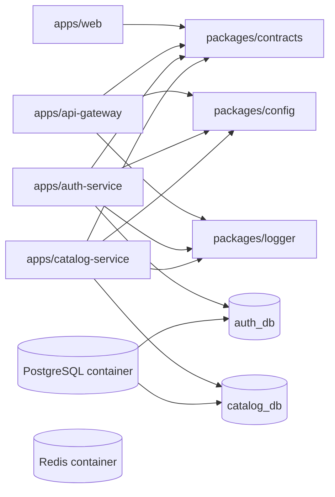

# Nexo Commerce — Phase 1 Design

## Goal

Establish a runnable, strict TypeScript monorepo for Nexo Commerce with a Next.js storefront shell, an API gateway, independent Auth and Catalog NestJS/Express services, and local PostgreSQL/Redis infrastructure.

## Scope

This phase includes only `web`, `api-gateway`, `auth-service`, `catalog-service`, shared contracts/config/logger/testing/configuration packages, Docker Compose, documentation, and the requested automated tests. Cart, orders, payments, messaging, Kubernetes, Terraform, distributed authorization, and dynamic proxying are deliberately excluded.

## Repository architecture

pnpm workspaces and Turborepo own build orchestration. Applications live in `apps/`; packages live in `packages/` and expose source TypeScript through workspace imports. The package graph is intentionally shallow:

`packages/contracts` contains response and request-only types, never persistence or business logic. `packages/config` parses app-specific environment variables with Zod. `packages/logger` provides Pino/Nest logger construction and request logging. Prisma clients, schemas, migrations, repositories, and domain modules remain local to the owning service.

## Backend convention

Every backend application creates its server with `NestFactory.create(AppModule)` from `@nestjs/platform-express`; Fastify is not installed or configured. Each service configures Helmet, CORS, a global validation pipe (`whitelist`, `transform`, and `forbidNonWhitelisted`), a Pino logger, a request-id middleware/interceptor, and a global HTTP exception filter.

The request ID is reused from a valid incoming `x-request-id` or generated with `randomUUID`, stored on the Express request, written to every response, included in error responses, and attached to request-completion logs. Error responses follow `{ statusCode, code, message, requestId }`; error details/stack traces are not exposed in production.

`api-gateway` exposes `/api/health`, Swagger at `/api/docs`, and no proxy behavior in this phase. `auth-service` exposes its public endpoints at `/auth/*` and `/health`; `catalog-service` exposes its public and temporary-admin endpoints at `/products`, `/categories`, and `/health`.

## Data ownership and security

The Compose PostgreSQL instance initializes `auth_db` and `catalog_db`, but this is logical database-per-service isolation. Auth owns a Prisma schema with `User` and `RefreshToken`; Catalog owns its own schema with `Category`, `Product`, and `ProductVariant`. UUID IDs, unique email/slug/SKU indexes, timestamps, and foreign keys are defined in their respective schemas.

Auth hashes passwords using Argon2. JWT access and refresh tokens use independent secrets and expirations. Refresh tokens are stored only as hashes; rotation revokes the source token and persists the new hash. JWT guards protect `GET /auth/me`. DTOs accept only intended fields and auth response DTOs never expose password/token hashes. Catalog administrative endpoints are purposefully unauthenticated in phase 1 and documented as temporary, avoiding a premature cross-service authorization protocol.

## Frontend

The Next.js App Router app is a dark, minimal, responsive initial storefront. It renders navbar, hero, product area, and reusable loading/empty/error visual states with local example state. It does not yet make catalog calls, which keeps the first phase independent of gateway routing decisions.

## Verification strategy

Jest unit tests cover auth registration, duplicate-email rejection, successful login, and bad-credential rejection using a mocked local Prisma dependency. Catalog tests cover create, detail retrieval, and list behavior using the same service-level pattern. Supertest boots lightweight Nest test modules and verifies public health/API boundaries. Repository scripts run lint, strict typechecking, build, tests, Prisma generation/migrations, and Compose lifecycle commands.

## Acceptance criteria

- `pnpm install`, `pnpm build`, `pnpm lint`, `pnpm typecheck`, and `pnpm test` finish successfully.
- `docker compose config` validates; PostgreSQL/Redis are defined with health checks and persistent volumes.
- Backends use Express and provide health endpoints, safe global error handling, validation, CORS, Helmet, structured logging, and response request IDs.
- Auth and Catalog have independent Prisma schemas and migration locations, with no shared persistence package.
- README and ADRs accurately describe the scope and decisions.

## Explicit limits

Runtime health checks report service availability rather than forcing a database query, so a newly cloned project can start before migrations run. The README documents the database migration prerequisite. Redis is provisioned for shared local infrastructure but not consumed until a later phase.
