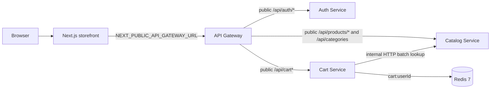

# Cart Service — Phase 2 design

## Goal

Add an authenticated, Redis-backed shopping cart while preserving the API Gateway as the only browser API. Cart owns only a user's selected variant IDs, quantities, temporary cart currency, and timestamp. Catalog remains the authority for products, variants, availability, prices, and currencies.

## Architecture and trust boundaries



The Gateway explicitly maps the five cart routes and forwards JSON, query strings, `Authorization`, `Content-Type`, and `x-request-id` through the existing `InternalServiceProxy`. Cart is an internal target only; it has no browser CORS configuration and no route is added that could proxy Catalog's `/internal/*` namespace.

The Gateway forwards the bearer token, but Cart validates it locally. Cart's JWT strategy accepts only unexpired HS256 access tokens with a UUID `sub` and `type: "access"`, using the same `JWT_ACCESS_SECRET` contract already used by Auth. This deliberately reuses the token contract without importing Auth's application module or calling Auth per request. A Cart-to-Catalog client accepts the request ID from the controller and sends it as `x-request-id`, completing the Gateway → Cart → Catalog correlation chain.

## Catalog integration

Catalog adds `POST /internal/variants/batch` with a validated, bounded array of UUIDs. It returns only requested variant data: variant and product IDs, product name, variant name, decimal-string price, currency, stock, and both active flags. It includes inactive records because Cart needs to distinguish `VARIANT_INACTIVE` and `PRODUCT_INACTIVE`; absent IDs represent `VARIANT_NOT_FOUND`.

Cart uses one batch request for every read/enrichment and for mutation validation. It never imports Catalog Prisma types or accesses `catalog_db`. Transport failure, timeout, a non-success response, invalid JSON, or an interrupted response body becomes the safe public `503 CATALOG_UNAVAILABLE` Cart error.

## Redis representation and lifecycle

The only Cart persistence is the Redis key `cart:{userId}`. Its JSON value is:

```json
{
  "currency": "USD",
  "items": [{ "variantId": "uuid", "quantity": 2 }],
  "updatedAt": "2026-09-13T00:00:00.000Z"
}
```

`currency` is temporary Cart metadata rather than a price snapshot. It establishes the single-currency invariant; no product description, image, price, or stock is stored. An empty cart has no Redis key and therefore no associated currency. `saveCart` writes with `EX 2592000` (30 days), so add, quantity replacement, and item deletion that leaves items renew the TTL. Removing the final item deletes the key; deleting a missing item and clearing a missing cart are idempotent and return success. A read does not renew the TTL.

The first variant added chooses the Cart currency. A later addition whose current Catalog currency differs fails with `409 CART_CURRENCY_MISMATCH`; the stored cart stays unchanged. Once all items are gone, the next added variant can establish a new currency. If Catalog later changes a saved variant's currency, Cart fails closed with the same conflict until the incompatible item is removed; this preserves a truthful single-currency total rather than mixing currencies silently.

## Cart behavior

`POST /cart/items` adds to an existing quantity and validates the resulting total against current Catalog stock. `PATCH /cart/items/:variantId` replaces a present item's quantity after the same current availability checks. Both require an integer quantity of at least one. `DELETE /cart/items/:variantId` and `DELETE /cart` are idempotent. `GET /cart` returns an empty Cart when no key exists; otherwise it batch-enriches each stored item and calculates decimal-string line subtotals and total with `decimal.js`, never JavaScript floating-point arithmetic.

The public response exposes current Catalog prices. A Cart is not a price commitment: **Cart price = current catalog price; Order price = immutable snapshot**. This phase only observes stock, so a stock change after validation and before a future checkout is expected. No inventory reservation, decrement, broker, Order, payment, or notification is introduced.

Domain failures use the existing error envelope with Cart-specific codes: `CART_ITEM_NOT_FOUND` (404), `VARIANT_NOT_FOUND` (404), `PRODUCT_INACTIVE` (409), `VARIANT_INACTIVE` (409), `INSUFFICIENT_STOCK` (409), `CART_CURRENCY_MISMATCH` (409), and `CATALOG_UNAVAILABLE` (503).

## Frontend

The storefront adds small client-side Cart controls: an Add to Cart action for the first active product variant, a Cart link/count in the navigation, and `/cart` with loading, empty, error, update, remove, and clear states. All requests use `NEXT_PUBLIC_API_GATEWAY_URL`; no Cart or Catalog internal URL appears in web code. The pre-existing frontend has no sign-in UI, so the Cart client reads an already-established browser access token from `localStorage` key `nexo.access-token` and renders the Gateway's 401 as an actionable sign-in error. It does not add a new authentication product flow in this phase.

## Validation and documentation

Cart unit/HTTP tests use a mocked Redis client and a controlled internal Catalog HTTP server to verify storage, TTL, JWT protection, all specified domain paths, current price math, currency isolation, error envelopes, and request-ID propagation. Gateway tests use controlled HTTP Cart targets. Catalog tests verify the deliberately narrow internal endpoint; Gateway Swagger and proxy tests prove it remains absent from public routing. Web tests mock fetch and local storage to prove Gateway-only URLs and basic Cart state transitions.

README and a new Phase 2 architecture document describe Cart ownership, Redis TTL, the single-currency rule, Cart-to-Catalog lookup, public Gateway routes, current-price behavior, and the intentional absence of inventory reservation.
